<!-- ========== HEADER ========== -->
<div align="center">



<a href="https://github.com/fadlanfatardilla">
  
</a>

<br />


</div>

<br />

<!-- ========== ABOUT ========== -->
## 👾 &nbsp;About Me

```ts
const fadlan = {
  name: "Fadlan Fatardilla Sumaila",
  role: "Software Engineer",
  currentlyBuilding: "Kanban-style task management app",
  currentlyLearning: ["Next.js", "TypeScript", "Prisma"],
  askMeAbout: ["JavaScript", "TypeScript", "PHP", "Web Development"],
  funFact: "Powered by curiosity, caffeine, and way too many open browser tabs",
};
```

<br />

<!-- ========== TECH STACK ========== -->
## 🛠 &nbsp;Tech Stack

**Languages**


**Front End Development**


**Frameworks & Build Tools**


<br />

<!-- ========== STATS ========== -->
## 📊 &nbsp;GitHub Stats

<div align="center">

<a href="https://github.com/fadlanfatardilla">
  
  
</a>

<br /><br />


</div>

<br />

<!-- ========== CONTACT ========== -->
## 📡 &nbsp;Let's Connect

<div align="center">

[](https://github.com/fadlanfatardilla)
[](mailto:fadlanfatardilla@gmail.com)
[](https://linkedin.com/in/fadlanfatardilla)

</div>

<br />

<!-- ========== FOOTER ========== -->

